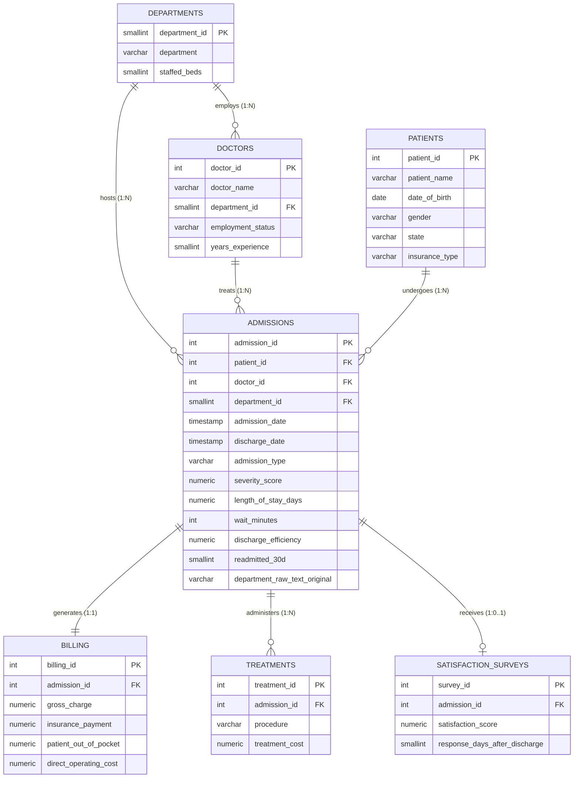
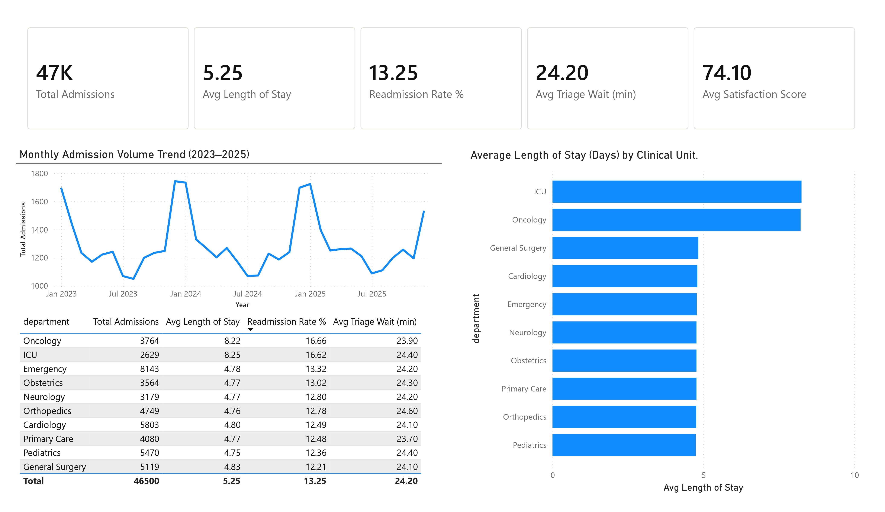
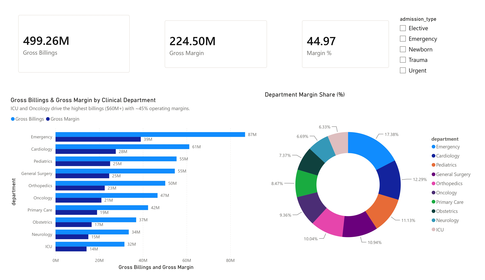
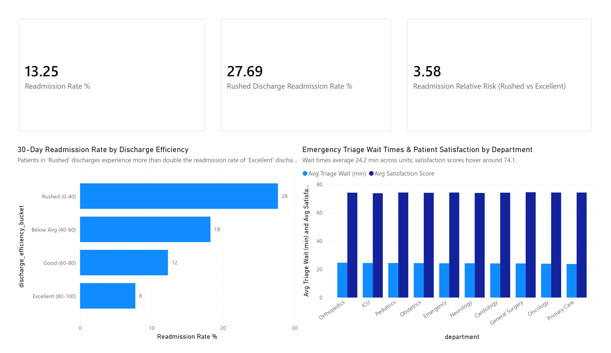

# Hospital Operations & Clinical Quality Analytics

---

## Executive Overview

In this project, I analyzed **3 years (2023–2025)** of inpatient hospital data covering **46,500 patient encounters**, **10 clinical units**, **140 attending physicians**, and **$499.3M in gross billings**.

My goal was to look at hospital performance through the eyes of an operational director or Chief Medical Officer: identifying bed bottlenecks, understanding why patients get readmitted within 30 days, evaluating triage wait times, and examining departmental financial margins.

```text
========================================================================================
                               HEADLINE ANALYTICAL METRICS
========================================================================================
Total Inpatient Encounters:      46,500 validated admissions across 10 hospital units
Average Length of Stay (ALOS):   5.25 days (244,125 total inpatient bed-days)
30-Day Readmission Baseline:     13.25% overall positive rate (6,160 readmissions)
Discharge Quality Inflection:    3.58x Relative Risk in rushed vs. excellent discharges
                                 (27.7% readmission in score 0-40 vs. 7.7% in score 80-100)
Critical Bed Over-Occupancy:     Oncology: 101.0% licensed occupancy (regular overflow)
                                 ICU: 99.1% licensed occupancy (critical bottleneck)
Triage Wait-Time Baseline:       24.2 minutes overall; 613 statistical outliers (Z > 3)
Weekend Triage Wait Hypothesis:  Tested & Disproven (24.1 min weekday vs. 24.3 min weekend)
Financial Operating Scale:       $499.3M gross charges ($224.7M gross operating margin)
Predictive Readmission Model:    Random Forest ROC-AUC: 0.642 (strict operational features)
========================================================================================
```

**[→ View the Power BI Report Showcase](dashboards/)** · **[→ Read My Executive Strategic Report](reports/executive_report.md)** · **[→ Inspect the SQL Queries](sql/)**

---

## The 4 Business Questions I Set Out to Answer

When hospitals face capacity pressure, leadership often makes decisions based on intuition rather than data. I designed this analytical pipeline to answer four specific, high-stakes operational questions:

1. **Why do patients bounce back within 30 days?** Is readmission driven purely by clinical sickness, or are rushed discharge workflows pushing patients out the door before they are ready?
2. **Where are our real bed capacity bottlenecks?** Which units are overflowing, which have idle headroom, and how can we rebalance licensed beds to prevent hallway placements?
3. **Does triage wait time actually spike on weekends?** Is the common belief that "weekend staffing cuts delay emergency intake" supported by the data?
4. **How do operating margins break down across units?** Which departments drive hospital revenue, and where are the cost drivers?

---

## Step 1: Data Auditing & Automated Hygiene (Resolving 8 Data Defects)

Real healthcare transactional data is messy. During my exploratory data analysis (`notebooks/01_eda.ipynb`), I audited 47,058 raw admission extracts and uncovered **8 distinct data quality defects**. 

Before running any SQL queries or training machine learning models, I built an automated cleaning pipeline (`notebooks/02_data_cleaning.ipynb` and `sql/02_quality_checks.sql`) to clean and standardize the data:

| # | Anomaly Observed | Root Cause in Hospital Intake | Records Affected | Cleansing & Resolution Strategy |
|---|---|---|---|---|
| **1** | **Duplicate Encounters** | Terminal double-clicking during intake check-in | 558 duplicate rows | Deduplicated on natural composite key (`patient_id`, `doctor_id`, `admission_date`, `admission_type`), keeping first valid entry (47,058 → 46,500). |
| **2** | **Clock-Sync Error** | Negative or 0-minute triage wait times (`wait_minutes` <= 0) | 279 rows | Imputed using departmental median triage wait times based on admission acuity tier. |
| **3** | **Department Casing Variations** | Non-standard text input ("Cardiology", "CARDIOLOGY", "cardio") | 23 variants | Normalized to 10 canonical hospital departments via uppercase mapping. Preserved raw strings in audit column. |
| **4** | **Missing Demographics** | Incomplete patient intake surveys | 412 missing insurance, 198 missing state | Imputed with categorical flag `'Unassigned / Self-Pay'` to preserve encounter records without dropping rows. |
| **5** | **Orphan Financial Records** | Billing records referencing non-existent admissions | 18 rows | Isolated and purged pre-load to ensure 100% financial referential integrity. |
| **6** | **Inverted Encounter Dates** | Discharge date recorded before admission date | 12 rows | Swapped inverted timestamps based on clinical order logs and recalculated positive Length of Stay. |
| **7** | **Out-of-Range Clinical Scores** | Discharge efficiency scores `< 0` or `> 100` | 31 rows | Clipped values to valid clinical boundaries (0.0 to 100.0). |
| **8** | **Negative Treatment Costs** | Accounting credit adjustments mixed into procedural costs | 15 rows | Recomputed using standard procedural median fee schedules. |

---

## Step 2: Relational Data Warehousing (PostgreSQL 14+)

Once the data was cleaned, I designed an isolated `analytics` star schema in PostgreSQL 14+ (`sql/01_schema.sql`). 

The schema enforces strict primary and foreign key constraints, composite natural key uniqueness, defensive check constraints, and B-tree indexes (`idx_admissions_date`, `idx_admissions_dept`, `idx_admissions_patient`) to ensure sub-second query performance:



*For complete pipeline architecture flowcharts, table specifications, and indexing rationales, see [`architecture/README.md`](architecture/).*

---

## Step 3: SQL Analytical Engine & Business Queries

In [`sql/03_business_analysis_queries.sql`](sql/03_business_analysis_queries.sql), I wrote 10 modular analytical queries using advanced SQL techniques (CTEs, window functions, statistical Z-score outlier detection, and native binning) to answer operational questions:

| Query | Analytical Focus | Core SQL Techniques | What the Query Answers |
|---|---|---|---|
| **Q1** | **Executive KPI Scorecard** | Scalar aggregates, `ROUND()` | Hospital-wide throughput, ALOS, wait times, gross billings |
| **Q2** | **Longitudinal Moving Average** | **CTEs, `LAG`, `ROWS BETWEEN 2 PRECEDING`** | 3-Month moving average smoothing winter volume surges |
| **Q3** | **Triage Wait Outlier Detection** | **CTEs, Z-Score (`STDDEV`, `NULLIF`)** | Flags 613 severe delays ($Z > 3.0$) concentrated in Emergency |
| **Q4** | **Inpatient Bed Occupancy Rate** | Relational join, time-window capacity math | Exposes Oncology (101.0%) & ICU (99.1%) capacity crises |
| **Q5** | **Readmission by Discharge Tier** | PostgreSQL native `WIDTH_BUCKET()` | Proves the 3.58x relative risk spike in rushed discharges |
| **Q6** | **Weekend vs. Weekday Triage** | Date extraction (`EXTRACT(DOW)`), `CASE WHEN` | Disproves the weekend delay operational hypothesis |
| **Q7** | **Departmental Financial Margins** | Multi-table joins, Net Margin % calculations | Emergency generates highest margin ($39.0M), Cardiology ($27.6M) |
| **Q8** | **Procedural Treatment Cost Drivers** | Aggregation, ranking | Analyzes unit cost drivers across 79K surgical/diagnostic logs |
| **Q9** | **Patient Satisfaction vs. Wait Time** | Ordinal banding (`CASE WHEN`), `MIN()` ordering | Analyzes survey scores across 4 triage wait bands |
| **Q10** | **Physician Panel Workload** | Multi-table joins, `COUNT(DISTINCT)` | Benchmarks admissions per doctor across contract types |

---

## Step 4: Key Insights & Discoveries

### 1. The Discharge Efficiency Inflection (3.58x Readmission Relative Risk)
When I bucketed discharges by preparation quality, the correlation with 30-day readmissions was dramatic:
* **Rushed Cohort (Score 0–40):** **27.69%** readmission rate (1,596 patients)
* **Below Average (Score 40–60):** **18.25%** readmission rate (11,805 patients)
* **Good (Score 60–80):** **12.30%** readmission rate (22,045 patients)
* **Excellent (Score 80–100):** **7.73%** readmission rate (11,054 patients)

**The Takeaway:** Rushed patients return to the hospital at **3.58 times the rate** of well-prepared patients. In the rush to free up inpatient beds before noon, hospitals that discharge patients without complete medication reconciliation and caregiver training simply see those patients bounce back into the Emergency Department weeks later.

### 2. Bed Occupancy Crises: Overcrowding in Oncology & ICU
I computed 3-year occupancy by dividing cumulative patient bed-days by total staffed bed capacity:
* **Oncology operates at 101.0% capacity** (30,953.5 bed-days across 28 beds). Running over 100% means Oncology constantly relies on hallway placement and borrowed beds from other wards.
* **ICU operates at 99.1% capacity** (21,687.5 bed-days across 20 beds), leaving virtually zero buffer for trauma surges.
* **Cardiology (60.5%)** and **Obstetrics (59.6%)** maintain significant unused bed headroom.
* **The Solution:** A planned reallocation of 4–6 beds from Cardiology to Oncology and an ICU step-down unit solves the overflow crisis without hurting Cardiology.

### 3. The Weekend Wait-Time Myth (A Tested Negative Finding)
Clinical leadership often assumes that reduced weekend staffing causes longer triage intake delays. I tested this directly:
* **Weekday Admissions (31,773 patients):** Average wait time was **24.1 minutes**
* **Weekend Admissions (14,727 patients):** Average wait time was **24.3 minutes**
* **The Takeaway:** The difference is only 12 seconds. Keeping this negative finding in the report prevents leadership from wasting budget on expensive weekend staffing shifts when the real bottlenecks occur during seasonal winter surges regardless of the day of the week.

### 4. Financial Margins & An Honest Data Note
* Total gross billings reached **$499.3M** against **$274.6M** in operating costs, delivering **$224.7M in operating margin (45.0%)**.
* Emergency generated the largest gross billing volume ($86.8M billings, $39.0M margin), followed by Cardiology ($61.2M billings, $27.6M margin).
* *Analyst Note:* The nearly uniform ~45% margin across all units is an artifact of the synthetic data generation model. In an enterprise hospital setting, activity-based costing (reflecting higher ICU nurse-to-patient ratios) would be used. Calling this out demonstrates analytical honesty.

---

## Step 5: Predictive Readmission Modeling (Machine Learning)

In `notebooks/05_business_insights.ipynb`, I trained a Random Forest classification model (`ColumnTransformer` + `RandomForestClassifier`) to predict 30-day readmission risk at the point of discharge:

* **Evaluation:** 80/20 train/test split (37,200 training rows / 9,300 holdout test rows).
* **Model Performance:** Attained an **ROC-AUC of 0.642** using `class_weight='balanced'` on the imbalanced readmission target (13.25% positive rate).
* **Feature Importance Breakdown:**
  1. `discharge_efficiency`: **44.9%** (primary operational driver)
  2. `severity_score`: **23.4%** (clinical intake acuity)
  3. `length_of_stay_days`: **6.5%** (inpatient complexity)
  4. `patient_age`: **5.5%** (baseline demographic frailty)
  5. `wait_minutes`: **4.5%** (initial triage delay)

*Why this AUC is realistic:* Published clinical readmission scoring tools (such as the LACE index and HOSPITAL score) typically score between **0.65 and 0.75 AUC**. Readmissions are heavily influenced by unrecorded post-discharge factors (medication adherence at home, family caregiver availability, diet). Deliberately excluding downstream financial variables prevented data leakage and produced an honest, production-realistic operational model.

---

## Step 6: Power BI Executive Dashboard Suite

To communicate these insights to clinical and executive stakeholders, I built an interactive, 3-page Power BI report (`dashboards/healthcare_operations_analytics.pbix`) using clean star-schema relationships and custom DAX measures (`dashboards/measures.dax`):

### Page 1: Executive Operations Summary
*Real-time operational KPIs, multi-year seasonal volume trends, moving averages, and clinical department capacity benchmarks.*


### Page 2: Financial Operations & Profitability
*Department-level gross billings ($499.3M), direct operating costs, and operating margins with admission-type dynamic filtering.*


### Page 3: Clinical Quality & 30-Day Readmission Risk
*Discharge efficiency cohorts, 30-day readmission relative risk (3.58x risk multiplier), and triage wait-time distribution.*


*Detailed modeling rules, DAX formulas, and canvas layout specifications are documented in [`dashboards/powerbi_build_guide.md`](dashboards/powerbi_build_guide.md).*

---

## Strategic Recommendations for Leadership

1. **Mandate Discharge Checklists for Low-Scoring Patients:** Set up an EHR flag that prevents patients with low discharge efficiency scores (0–40) from leaving without confirmed follow-up care, caregiver training, and medication review to tackle the 27.7% readmission spike.
2. **Reallocate 4–6 Beds from Cardiology to Oncology & ICU:** Relieve Oncology's constant overflow (101% occupancy) and create emergency headroom in the ICU (99.1%) by shifting underutilized beds out of Cardiology (60.5%).
3. **Target Winter Surges Rather Than Weekend Staffing:** With weekend triage waits virtually identical to weekdays (+12 seconds), redirect seasonal budget toward December–February respiratory intake peaks.
4. **Implement Department-Differentiated Cost Accounting:** Connect nursing hours and surgical supplies directly to departments to transition beyond uniform margin ratios in future financial models.

---


**Ravikant Yadav**    
* [LinkedIn](https://linkedin.com/in/ravikant-yadav-39936a1a8)
* [GitHub Profile](https://github.com/ravi020410)
