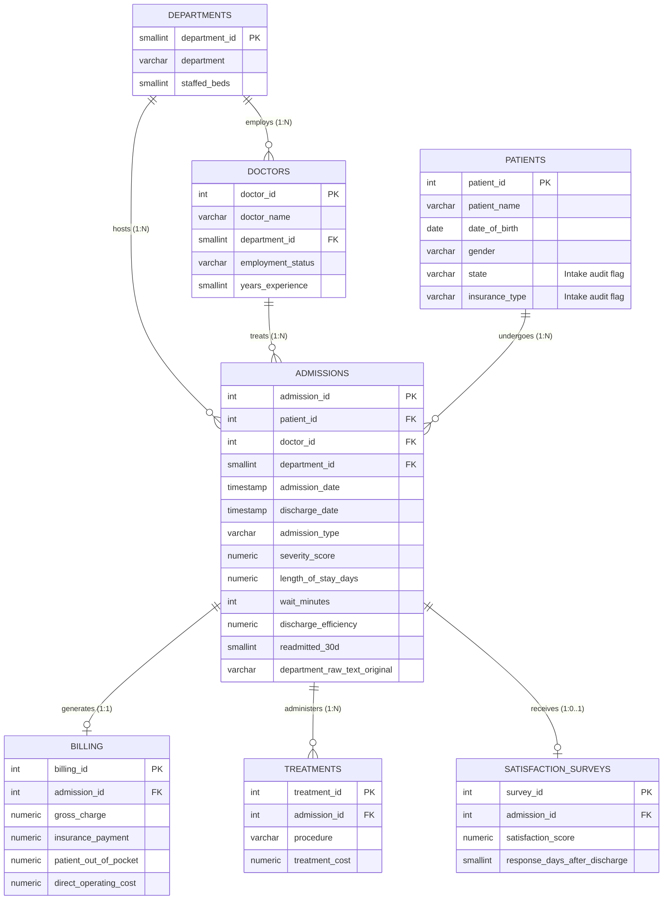

# Data Architecture & Relational Star Schema

## Entity-Relationship Diagram (PostgreSQL Star Schema)

---

## Relational Data Model Specifications

| Entity Name | Database Object | Primary Key | Foreign Keys | Relationship Type | Record Volume | Description |
|---|---|---|---|---|---|---|
| **Admissions** | `analytics.admissions` | `admission_id` | `patient_id`, `doctor_id`, `department_id` | Central Fact Table | 46,500 rows | Clinical encounter facts capturing admission/discharge timestamps, admission acuity, length of stay (LOS), triage wait, discharge efficiency index, and 30-day readmission status. |
| **Patients** | `analytics.patients` | `patient_id` | None | Dimension (1:N with Admissions) | 18,000 rows | Longitudinal patient master tracking demographics, age cohort, geographic state, and primary health insurance coverage (16,606 with active encounter history). |
| **Doctors** | `analytics.doctors` | `doctor_id` | `department_id` | Dimension (1:N with Admissions) | 140 rows | Attending medical provider master holding physician name, department assignment, employment contract status, and clinical tenure. |
| **Departments** | `analytics.departments` | `department_id` | None | Dimension (1:N with Admissions/Doctors) | 10 rows | Operating clinical units (ICU, Oncology, Cardiology, Emergency, etc.) along with licensed staffed bed counts. |
| **Billing** | `analytics.billing` | `billing_id` | `admission_id` | Secondary Fact (1:1 with Admissions) | 46,500 rows | Encounter financial ledger recording gross charge billings, insurance reimbursements, patient out-of-pocket payments, and operating costs. |
| **Treatments** | `analytics.treatments` | `treatment_id` | `admission_id` | Secondary Fact (1:N with Admissions) | 79,050 rows | Clinical interventions and procedure logging detailing diagnostic tests, surgical interventions, and direct procedural supply costs. |
| **Satisfaction Surveys** | `analytics.satisfaction_surveys` | `survey_id` | `admission_id` | Secondary Fact (1:0..1 with Admissions) | 26,970 rows | Post-discharge patient experience surveys measuring patient satisfaction ratings (0–100 scale) and survey turnaround duration. |

---

